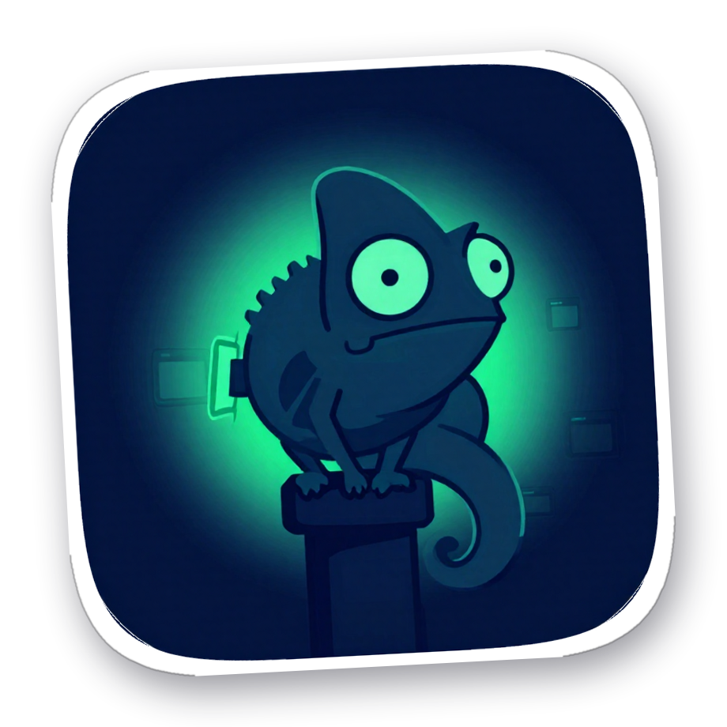

<p align="center"></p>

# browser-bays

[Website](https://pelayomendez.github.io/browser-bays/) · [Changelog](CHANGELOG.md)

A Claude Code plugin that parks each session in its own coloured, persistent browser bay, so parallel agents test in parallel without sharing a browser, a login or a port.

## Why

Run two or three Claude Code sessions that check UI at the same time and they end up in the same controlled browser: one locks the profile, another loses its login, a third navigates away from the page someone else was testing. Juggling several browser MCP servers by hand (`chrome-devtools`, `chrome-devtools-2`, …) and telling each session which one is its own does not scale.

browser-bays gives every session its own **bay**: a browser with its own persistent profile, its own colour and its own description. You log in once per bay and always know which window belongs to which session.

## What it does

**A band above the prompt** shows the session's bay in its colour, its driver, whether it is visible or headless, and what it is for:

```
● bay red · chrome · visible · Projects → http://localhost:3001 → :3001   [Focus] [Bays]
```

`[Focus]` brings the bay's window to the front, and reopens it if you closed it.

**`/bays`** (or `[Bays]`) lists every bay, who holds it and what each session said it is using it for:

```
● red    this session · chrome-devtools · visible · browser open
         app: Projects · url: http://localhost:3001 · port 3001
● blue   held (pid 87142) · chrome-devtools · visible
         app: Scene Builder · url: http://localhost:3002 · port 3002
● green  free · chrome-devtools · visible                          [Take]
```

- **One bay per session.** A new session takes the first free bay; `/bay blue` moves it and gives the old one back. A bay is held while its session's browser server runs, so it frees itself when the session ends.
- **Persistent.** Each bay keeps its own browser profile under `~/.browser-bays/profiles/`, so logins survive across sessions.
- **Coloured.** Chrome bays get a toolbar in the bay's colour, and the window title carries its name.
- **Described.** Agents record the app, URL, dev-server port and notes with the `bay_describe` tool and check the ports other sessions took with `bay_info`. The bay's description reaches the model with your next message whenever it changes.
- **Light.** An idle bay's browser closes after ten minutes without a browser call and reopens, still logged in, on the next one.
- **Any driver.** Chrome (chrome-devtools-mcp) by default, Firefox (firefox-devtools-mcp) built in, or any MCP server you add.

## Install

```
/plugin marketplace add pelayomendez/browser-bays
/plugin install browser-bays@pelayomendez-browser-bays
```

Requires Claude Code 2.1.330 or newer, Node.js (for `npx`) and Chrome. Focus uses `osascript` on macOS; elsewhere it falls back to the browser's own bring-to-front.

To keep your own browser MCP servers out of sessions, so agents only use their bay, list them under `holdServers` (below).

## Commands

| Command | What it does |
| --- | --- |
| `/bay` | This session's bay: driver, mode, app, URL, port, notes |
| `/bay <name>` | Take that bay (moving from the current one) |
| `/bay focus` | Bring the bay's window to the front |
| `/bay allow` | Which bays auto mode lets agents drive, and the rule for each |
| `/bay app\|url\|port\|notes <text>` | Describe what this session uses the bay for |
| `/bay save` | Keep that description as the bay's default |
| `/bay headless on\|off` | Run the bay without a window (from its next start) |
| `/bay driver [name]` | Show or change the bay's driver (from its next start) |
| `/bays` | All bays, who holds each, what for |

## Permissions under auto mode

In auto mode a classifier reviews each tool call that no permission rule covers. Reading a page (navigate, snapshot, screenshot, `evaluate_script`) usually passes; editing through it (a click on Save or Remove, Enter to commit a field) can be refused as a destructive action. The fix is an allow rule per bay in your user settings (`~/.claude/settings.json`), because [allow rules resolve before the classifier](https://code.claude.com/docs/en/permission-modes.md#how-the-classifier-evaluates-actions):

```json
"permissions": {
  "allow": [
    "mcp__plugin_browser-bays_bay-1__*",
    "mcp__plugin_browser-bays_bay-2__*"
  ]
}
```

`/bay allow` lists each bay with its rule and whether you have it. In `/bays`, **Allow** on a bay adds its rule to your user settings. The plugin never adds a rule on its own, and an agent cannot press the button.

- **Per bay, not per plugin.** Claude Code has no allow glob across servers (`mcp__plugin_browser-bays_*` is skipped), so the rule names one bay. That is also the useful scope: the risk lives in a bay's profile and the logins in it. Leave a bay unallowed if it is logged in somewhere you do not want agents clicking unattended.
- **Bays are shared.** A rule follows the bay, not the session: every session that takes that bay, now or later, drives it without review.
- **Subagents need the rule.** Under auto mode the classifier judges a subagent's calls with [the main session's allow rules](https://code.claude.com/docs/en/sub-agents.md#control-subagent-capabilities), so a settings rule covers them.
- **One-off approvals don't stick.** Approving a single refused call covers that call only. Browser calls carry the page id, which changes whenever the bay's browser restarts, so the approval does not match the next one.
- **Reads only.** To let agents look but still review edits, allow single tools instead of `__*`, e.g. `mcp__plugin_browser-bays_bay-2__take_snapshot`. Tool names follow the bay's driver.

## Config

`~/.browser-bays/config.json`, written on first use (`BROWSER_BAYS_HOME` moves the folder):

```json
{
  "autoAssign": true,
  "idleMinutes": 10,
  "holdServers": ["chrome-devtools"],
  "bays": [
    { "id": "bay-1", "name": "red", "color": "#E5484D", "emoji": "🔴", "headless": false,
      "driver": "chrome-devtools", "app": "Projects", "url": "http://localhost:3001" }
  ]
}
```

- `autoAssign`: a new interactive session takes the first free bay.
- `idleMinutes`: close an idle bay's browser after this many minutes (`0` keeps it open).
- `holdServers`: other MCP servers to keep out of every session.
- Bay ids `bay-1` … `bay-4` are fixed by the plugin; names, colours, drivers, modes and descriptions are yours.

## Drivers

A bay's `driver` picks the MCP server that runs its browser. Add your own under `drivers`:

```json
"drivers": {
  "my-browser": {
    "label": "My browser MCP",
    "command": "npx",
    "args": ["-y", "my-browser-mcp@latest", "--profile", "{profile}"],
    "headlessArgs": ["--headless"],
    "process": "{profile}"
  }
}
```

`{profile}`, `{name}`, `{emoji}` and `{color}` are filled in per bay; `process` identifies the browser's main process for Focus and the idle close. Each driver has its own tool names, so the model reads the bay's tools as they are.

## How it works

The plugin declares one MCP server per bay. At session start it holds every bay server back, then connects only the bay the session takes. The bay's launcher refuses any dial the session did not ask for and records its PID in `~/.browser-bays/run/`, which is how other sessions see the bay as held and how it frees itself. Descriptions are shared through the same folder.

## License

MIT
